# Guía de pantallas

Describe cómo deben verse y comportarse las pantallas de la aplicación: las reglas comunes, las reglas de validación de cada campo y lo que debe tener cada pantalla. Toda historia con pantalla se diseña y se revisa contra esta guía. Se acordó después del Sprint 3.

> **Diseño objetivo, no estado actual.** Algunas pantallas todavía no existen y otras cambiaron por decisiones posteriores. Ver [Estado de implementación](#estado-de-implementación-cierre-del-sprint-5).
>
> Cada pantalla tiene su imagen en [`pantallas/`](pantallas/). Las imágenes son estáticas: ver [Imágenes de las pantallas](#imágenes-de-las-pantallas) para saber cuándo y cómo se actualizan.

## Reglas para todas las pantallas

- Toda pantalla con sesión lleva el **encabezado común**: nombre del sistema, menú según el rol, usuario y rol, y el botón «Cerrar sesión» (formulario POST con CSRF).
- El menú solo muestra lo que el rol puede usar: **nunca un enlace que termine en 403**.
- Los estados se muestran con **texto e icono**, nunca solo con color.
- Las acciones que no se pueden deshacer (rechazar, revocar, sustituir) **piden confirmación**.
- Los mensajes de éxito o error van arriba del contenido; toda lista tiene un **estado vacío**.
- Botones de **al menos 44 px de alto**; texto con contraste mínimo de **4.5:1**.
- En el código: **sin estilos ni scripts en línea** (lo exige la CSP). Se usan clases de `titulos.css` y JavaScript en archivos `.js`.
- **Documento de identidad:** completo solo en las páginas internas y en la credencial PDF. En las páginas públicas va enmascarado: se ocultan todos los caracteres salvo los últimos 4 que no sean guion, y los guiones quedan en su lugar (`8-123-4567` → `•-•••-4567`).
- Páginas públicas: sin menú interno y pensadas primero para celular.
- Ninguna página debe terminar en la «Whitelabel Error Page» de Spring.

## Validación de datos (HU-4.7)

**Principios**

- Valida el servidor (Bean Validation y el servicio). `maxlength` y `pattern` del HTML solo ayudan al usuario.
- Se define lo permitido, no lo prohibido.
- Se normaliza antes de validar, comparar y guardar: sin espacios al inicio o al final, y los documentos en mayúsculas.
- Opciones fijas = `enum` en Java + restricción en la base de datos.
- Los textos guardados se muestran con `th:text`, nunca con `th:utext`.
- El error va junto al campo, en lenguaje simple.

**Reglas por campo** (mínimo–máximo de caracteres)

| Campo | Regla |
|---|---|
| Tipo de documento | Cédula o Pasaporte. |
| Cédula | 5–20. Tres bloques de letras o números separados por guion (`8-940-1000`, `PE-5-614`, `N-17-371`). Se guarda con guiones, en mayúsculas y sin ceros a la izquierda en los bloques numéricos. `89401000` se rechaza: sin guiones no se sabe dónde termina cada parte. Pendiente confirmar con Secretaría General los formatos PI y AV. |
| Pasaporte | 5–20. Letras y números; al escribir se aceptan espacios y guiones, pero se guarda en mayúsculas y sin ellos. |
| Nombre del graduado | 3–120. Letras (con tildes, ñ y ü), espacios, apóstrofo, guion y punto; los espacios dobles se reducen a uno. |
| Nombre del título | 5–150 (acordado el 21/10/2026). Cuando exista el catálogo (HU-1.11): un programa activo del catálogo, con nombre de 5–150 y único. |
| Motivo de revocación o sustitución | 10–500. |
| Búsqueda | Vacía o 2–100. |
| Usuario (filtro de auditoría) | Vacío o 3–50. Busca el texto contenido en el usuario, sin distinguir mayúsculas (acordado el 26/10/2026). |
| Filtros de estado, acción e idioma | Solo valores de su lista. |
| Fechas de auditoría | Válidas; «desde» no puede ser posterior a «hasta». «Hasta» incluye todo ese día (acordado el 26/10/2026). |
| Paginación | Página desde 1; tamaño 10, 20 o 50. La auditoría (P6) usa 20 por página (acordado el 26/10/2026). |
| Código de verificación | Sin espacios al inicio o al final y en minúsculas antes de buscar. UUID de 36 caracteres; si no cumple, «No encontrado» sin consultar la base de datos. |
| Estado, revisor, fechas e identificador | Los pone el servidor, nunca el formulario. |

## Identidad visual

Basada en `src/main/resources/static/css/titulos.css`. Público: personal administrativo de la universidad y verificadores externos.

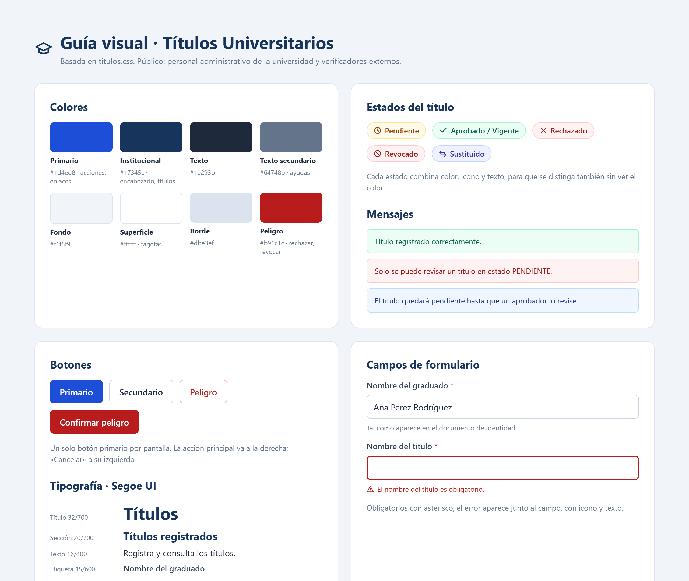

| Uso | Color |
|---|---|
| Primario (acciones, enlaces) | `#1d4ed8` |
| Institucional (encabezado, títulos) | `#17345c` |
| Texto | `#1e293b` |
| Texto secundario (ayudas) | `#64748b` |
| Fondo | `#f1f5f9` |
| Superficie (tarjetas) | `#ffffff` |
| Borde | `#dbe3ef` |
| Peligro (rechazar, revocar) | `#b91c1c` |

- **Estados del título:** Pendiente (ámbar, reloj), Aprobado/Vigente (verde, visto), Rechazado (rojo, X), Revocado (rojo, círculo tachado), Sustituido (índigo, flechas). Cada uno combina color, icono y texto.
- **Botones:** un solo botón primario por pantalla. La acción principal va a la derecha y «Cancelar», a su izquierda. Variantes: primario, secundario, peligro y confirmar peligro.
- **Tipografía:** Segoe UI. Título 32/700, sección 20/700, texto 16/400 y etiqueta 15/600.
- **Campos:** los obligatorios llevan asterisco; el error aparece junto al campo, con icono y texto.

## Pantallas

### P1 · Iniciar sesión
Ruta `/login` · Público · HU-1.2, HU-1.5, HU-4.6

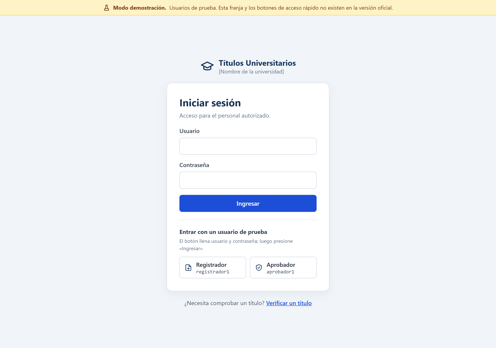

- Nombre del sistema y de la institución.
- Usuario y contraseña, cada uno con su etiqueta.
- Botón «Ingresar».
- Mensaje de credenciales incorrectas (`?error`) y de sesión cerrada (`?logout`).
- Enlace a «Verificar un título» (público).
- Al ingresar, llevar a `/titulos`.
- **Modo demostración (HU-4.6, solo con el perfil demo):** franja «Modo demostración» arriba de la página y botones «Registrador» y «Aprobador» que llenan usuario y contraseña (la persona presiona «Ingresar»). Sin el perfil demo no aparecen los botones ni existen los usuarios de prueba.

### P2 · Títulos
Ruta `/titulos` · Ambos roles · HU-1.3, HU-1.8, HU-1.10, HU-2.1

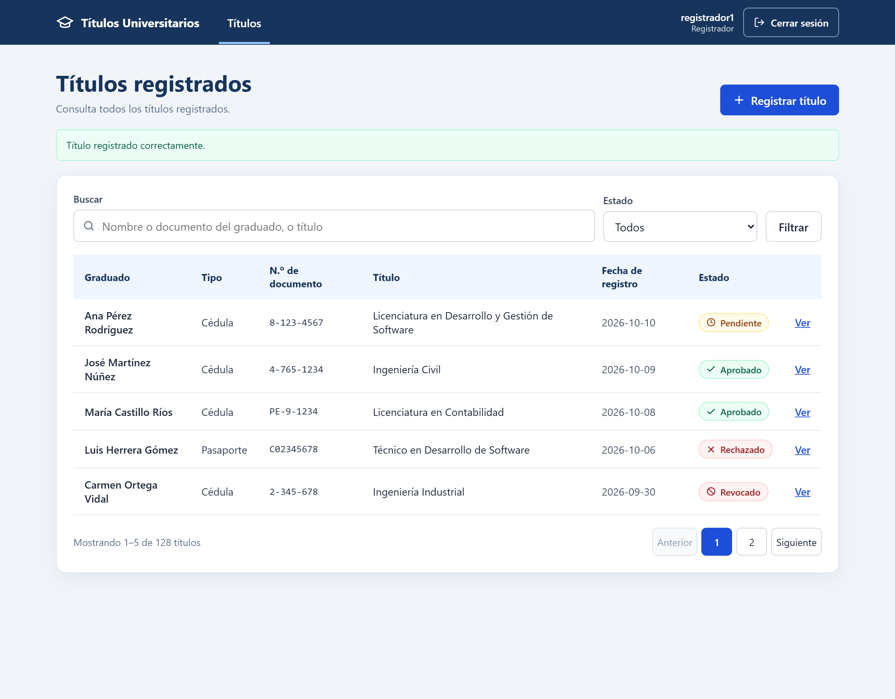

- Encabezado común.
- Título de la página y botón «Registrar título» (solo REGISTRADOR).
- Mensajes de éxito o error.
- Búsqueda por nombre o documento del graduado, o por título, y filtro por estado.
- Tabla: Graduado, Tipo de documento, N.º de documento, Título, Fecha de registro, Estado (insignia) y «Ver».
- Estado vacío y paginación (volumen esperado: 30 000 graduados).

### P3 · Registrar título
Ruta `/titulos/nuevo` · Solo REGISTRADOR · HU-1.3, HU-1.9, HU-1.10, HU-1.11

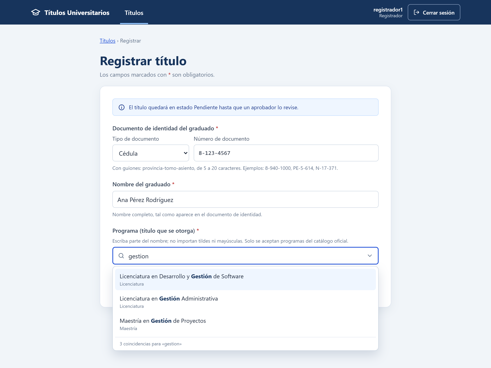

- Encabezado común y ruta de navegación (Títulos › Registrar).
- Campos obligatorios marcados (*) con texto de ayuda.
- Documento de identidad: tipo (Cédula o Pasaporte) y número, según la validación de datos.
- Programa: lista del catálogo con búsqueda, sin importar tildes ni mayúsculas; el servidor valida que el programa exista y esté activo (HU-1.11).
- Error junto al campo que falla, no solo arriba.
- Título duplicado (mismo documento y mismo programa): se rechaza, con enlace al registro existente.
- Documento ya registrado con otro nombre: aviso junto al campo del nombre.
- Aviso: el título queda PENDIENTE hasta que un aprobador lo revise.
- Botones «Cancelar» (secundario) y «Registrar título» (primario), a la derecha.

### P4 · Bandeja de revisión
Ruta `/titulos/pendientes` · Solo APROBADOR · HU-2.1

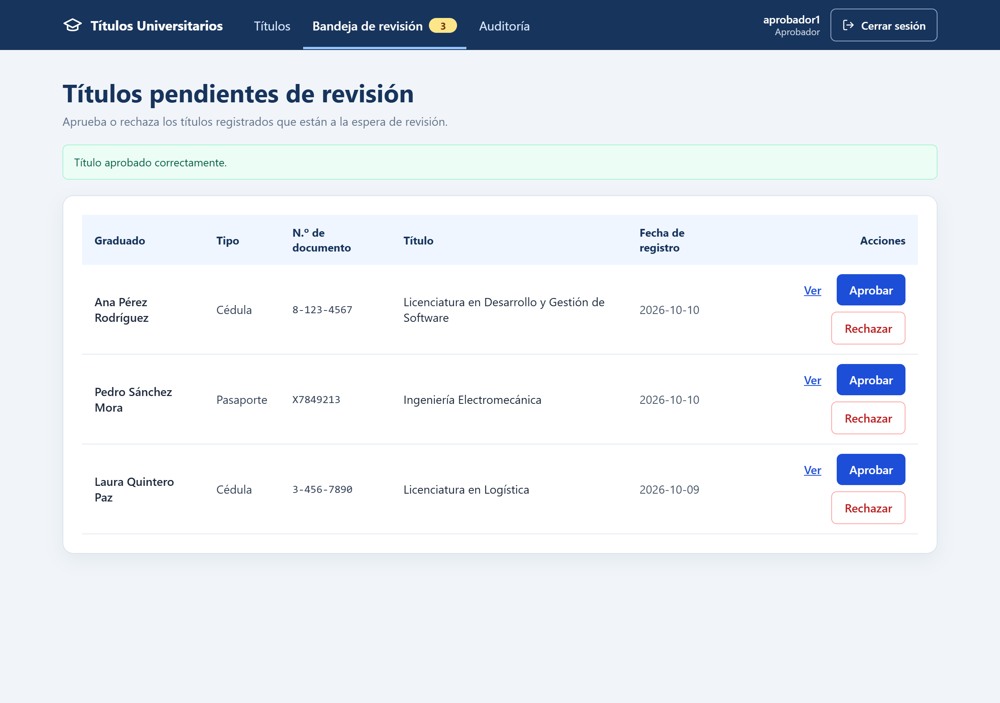

- Encabezado común con el contador de pendientes en el menú.
- Mensajes de éxito o error.
- Tabla: Graduado, Tipo de documento, N.º de documento, Título, Fecha de registro y acciones.
- Acciones: «Ver», «Aprobar» (primario) y «Rechazar» (peligro). «Rechazar» abre el diálogo de confirmación.
- Estado vacío: «No hay títulos pendientes de revisión».

### P5 · Detalle del título
Ruta `/titulos/{id}` · Ambos roles (acciones según el rol) · HU-2.1, HU-2.2, HU-2.4, HU-2.5, HU-3.2

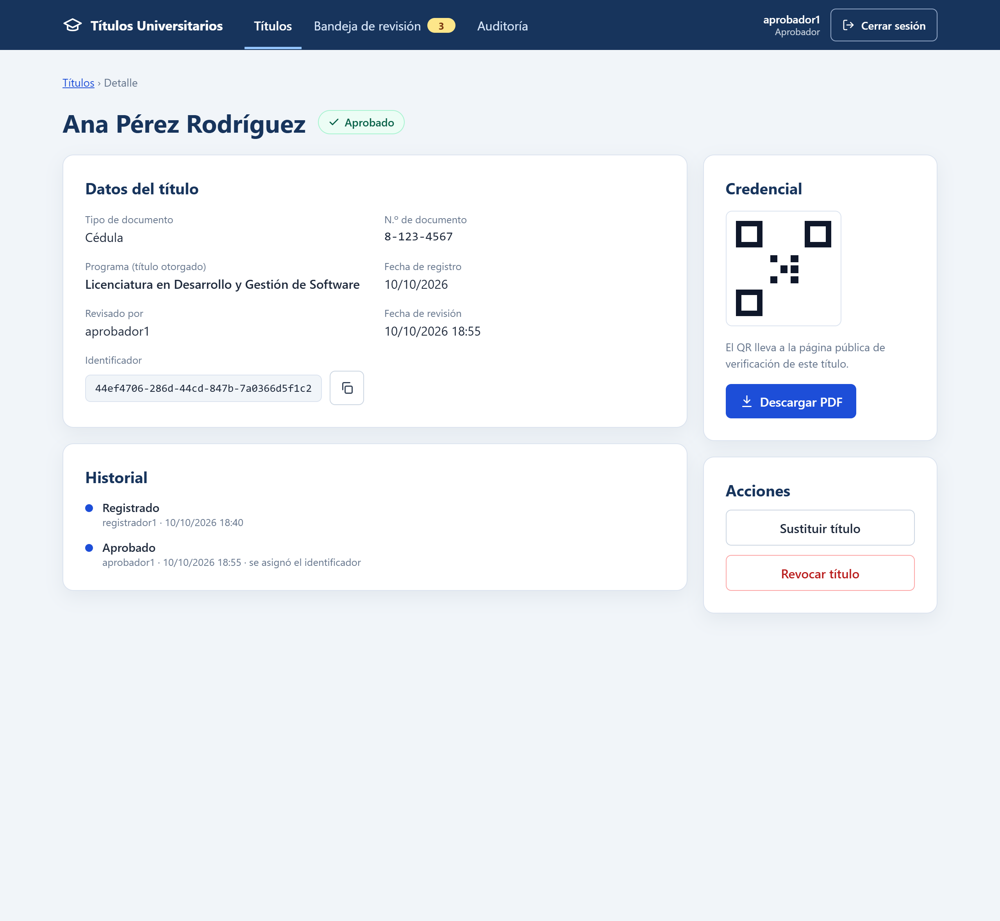

- Encabezado común y ruta de navegación.
- Nombre del graduado e insignia de estado.
- Datos: tipo y número de documento (completo), programa (título), fecha de registro, revisado por, fecha de revisión e identificador (con botón para copiar).
- Credencial (solo APROBADO): vista del QR y «Descargar PDF».
- Acciones del APROBADOR según el estado: aprobar o rechazar si está PENDIENTE; revocar o sustituir si está APROBADO.
- Historial del título (HU-3.3).

### Diálogo de confirmación
Se usa en rechazar, revocar y sustituir.

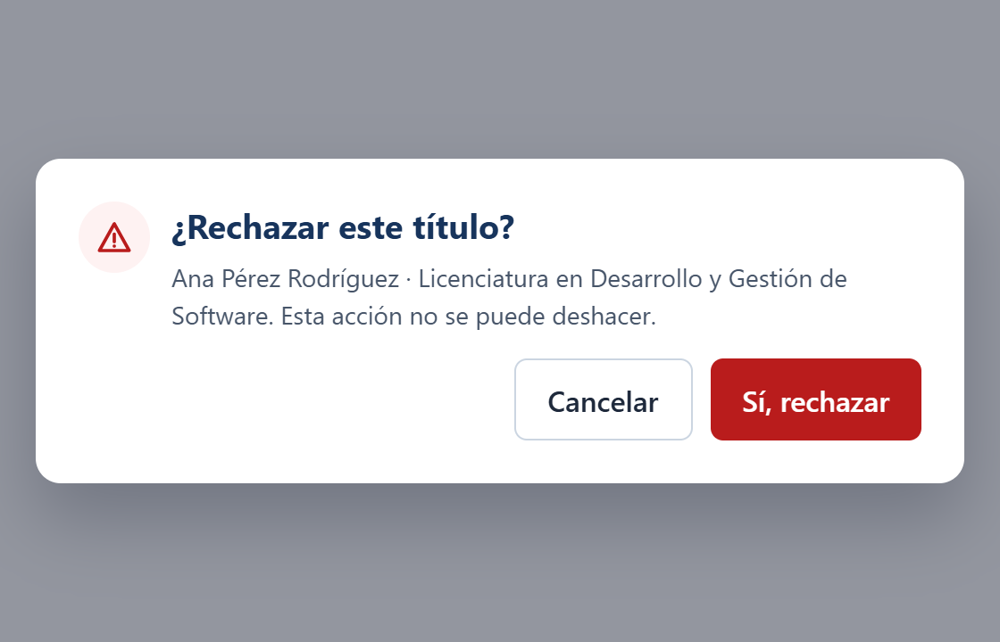

- Pregunta clara, con el nombre del graduado.
- Consecuencia: «Esta acción no se puede deshacer».
- Motivo obligatorio en revocar y sustituir.
- «Cancelar» con el foco inicial; el botón de peligro, a la derecha.
- Implementado con JavaScript en un archivo `.js`, no en línea (CSP).

### P6 · Auditoría
Ruta `/auditoria` · Solo APROBADOR · HU-3.4 (consulta del registro de HU-3.3)

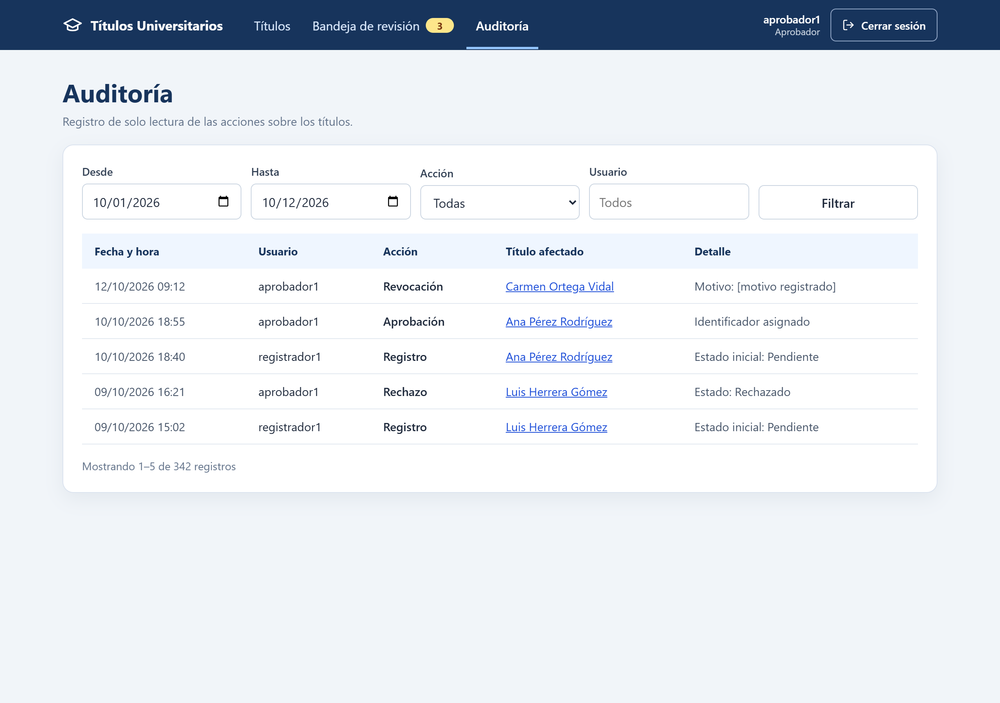

- Encabezado común.
- Filtros: rango de fechas, acción y usuario.
- Tabla: Fecha y hora, Usuario, Acción, Título afectado (graduado · título) y Detalle, de lo más reciente a lo más antiguo.
- Solo lectura: no se edita ni se borra.
- Estado vacío («No hay eventos con esos filtros») y paginación de 20 por página, con «Anterior», «Siguiente» y «Mostrando X–Y de N».

### P7 · Verificar título (celular)
Ruta `/verificar` · Público · HU-3.1

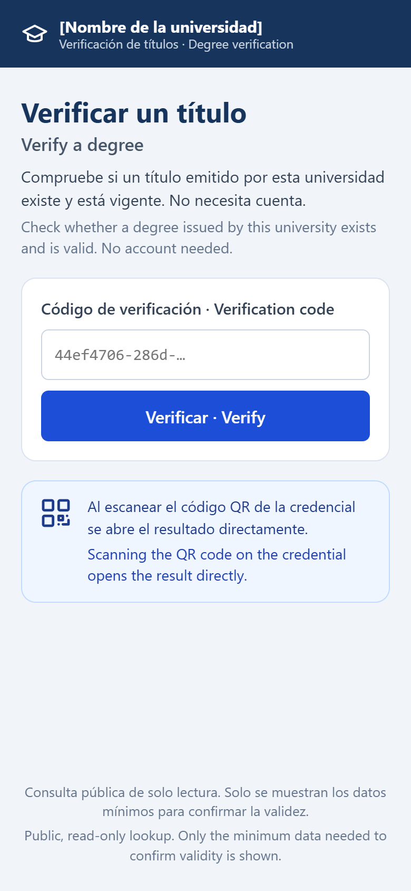

- Nombre de la institución.
- Textos en español e inglés a la vez, sin selector de idioma (verificabilidad internacional; acordado el 26/10/2026, igual que P8).
- Campo para el código y botón «Verificar».
- Indicación de que el QR lleva directo al resultado.
- Sin menú interno ni datos del personal.

### P8 · Resultado de verificación (celular)
Ruta `/verificar/{código}` · Público · HU-3.1, HU-3.2

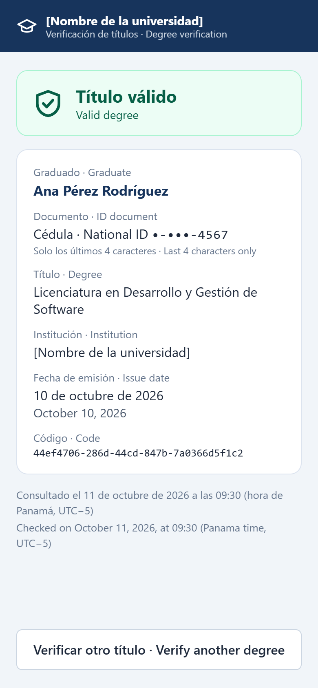

- Estado grande con icono: válido, revocado, sustituido o no encontrado.
- Solo datos mínimos: graduado, documento enmascarado (últimos 4 caracteres que no sean guion), título, institución, fecha de emisión y código.
- Fecha y hora de la consulta.
- Texto bilingüe ES / EN.
- Fechas como en la credencial, en los dos idiomas («10 de octubre de 2026 · October 10, 2026»); la consulta con la hora y la zona («hora de Panamá, UTC−5») (acordado el 26/10/2026).
- Nunca datos personales adicionales.

### P9 · Página de error
Rutas: 403, 404 y 500 · Todos · HU-4.5

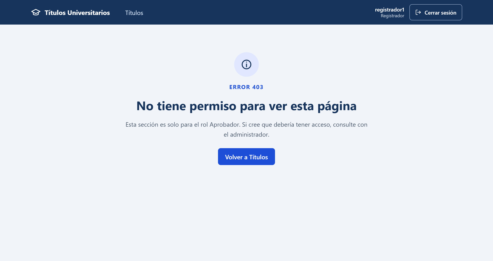

- Encabezado común si hay sesión.
- Código y mensaje en lenguaje simple.
- Qué puede hacer el usuario (volver a Títulos, iniciar sesión).
- Sin detalles técnicos ni trazas del servidor.
- Reemplaza la «Whitelabel Error Page» de Spring.

### D1 · Credencial PDF
Generada con PDFBox y ZXing · HU-2.4, HU-2.5, HU-2.8

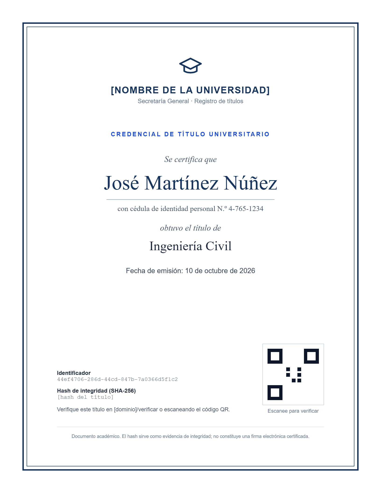

- Institución y título del documento.
- Nombre del graduado (con tildes) y título otorgado.
- Documento de identidad completo (cédula o pasaporte) debajo del nombre.
- Fecha de emisión e identificador.
- QR con la URL de verificación, sin datos personales, de al menos 2,5 cm con su margen blanco y la leyenda «Escanee para verificar» (HU-2.5).
- Hash de integridad en letra pequeña (HU-2.8).
- Texto: «Verifique este título en …/verificar o escaneando el código QR».
- Fuentes estándar del PDF (Times y Helvetica), para no incrustar fuentes.

## Estado de implementación (cierre del Sprint 5)

| Pantalla | Estado | Diferencias con la guía |
|---|---|---|
| P1 · Iniciar sesión | Parcial | Usa la página por defecto de Spring Security; la página propia es HU-1.5 y el modo demostración, HU-4.6. |
| P2 · Títulos | Parcial | Sin búsqueda ni paginación (HU-1.8) y sin «Ver» (HU-2.6). Tiene las columnas Estado y Credencial: «Descargar PDF» va en la lista hasta que exista el detalle (decisión del 20/10/2026). El estado se muestra como texto (`PENDIENTE`), sin insignia ni icono (sin historia asignada). |
| P3 · Registrar título | Implementada | El título es texto libre de 5–150 caracteres hasta el catálogo (HU-1.11). El duplicado se rechaza con el error bajo «Nombre del título», todavía sin el enlace al registro existente (HU-2.6). |
| P4 · Bandeja de revisión | Parcial | Sin «Ver» (HU-2.6). «Rechazar» todavía no pide confirmación ni usa el estilo de peligro (HU-2.7). |
| P5 · Detalle | Pendiente | HU-2.6. |
| P6 · Auditoría | Implementada | HU-3.4 (Sprint 6, PR #35). Los filtros van uno debajo de otro en lugar de en una fila, y «Título afectado» no lleva enlace hasta que exista el detalle (HU-2.6). |
| P7 y P8 · Verificación pública | Implementada | HU-3.1 (Sprint 6, PR #32). Los estados revocado y sustituido llegan con HU-3.2. |
| P9 · Página de error | Pendiente | HU-4.5. Hoy se ve la «Whitelabel Error Page». |
| D1 · Credencial PDF | Parcial | Sin QR (HU-2.5, Sprint 6) ni hash (HU-2.8, Sprint 7). Defecto conocido, que corrige HU-2.5: un nombre de tres líneas se monta sobre la línea separadora. |

## Imágenes de las pantallas

Las imágenes muestran el **diseño objetivo** y se suben a mano a `docs/producto/pantallas/`, en PNG. Son estáticas: no cambian solas cuando cambia el diseño.

| Archivo | Muestra |
|---|---|
| `00-guia-visual.png` | Colores, estados, botones y tipografía |
| `P1-iniciar-sesion.png` | P1 · Iniciar sesión |
| `P2-titulos.png` | P2 · Títulos |
| `P3-registrar-titulo.png` | P3 · Registrar título |
| `P4-bandeja-de-revision.png` | P4 · Bandeja de revisión |
| `P5-detalle-del-titulo.png` | P5 · Detalle del título |
| `C1-dialogo-de-confirmacion.png` | Diálogo de confirmación |
| `P6-auditoria.png` | P6 · Auditoría |
| `P7-verificar-titulo.png` | P7 · Verificar título (celular) |
| `P8-resultado-de-verificacion.png` | P8 · Resultado de verificación (celular) |
| `P9-pagina-de-error.png` | P9 · Página de error |
| `D1-credencial-pdf.png` | D1 · Credencial PDF |

Si una pantalla necesita más de una imagen (por ejemplo, con errores de validación), se agrega con un sufijo: `P3-registrar-titulo-errores.png`.

**Cuándo se actualiza una imagen:** cuando una historia corregida, una decisión del equipo o un Pull Request cambia el **diseño** de una pantalla: campos, columnas, botones, textos, colores o el paso de una pantalla a otra. Las diferencias temporales de implementación (por ejemplo, «Descargar PDF» en la lista hasta que exista el detalle) no cambian la imagen: se anotan en la tabla de estado.

**Cómo:**

1. Quien hace el cambio lo indica en su Pull Request, en «Acción requerida para el equipo».
2. El Product Owner reemplaza la imagen **con el mismo nombre de archivo**, para no romper los enlaces, y actualiza el texto de la pantalla en esta guía.
3. Mientras la imagen no se reemplace, la tabla de estado lo indica: «Imagen desactualizada: …».
